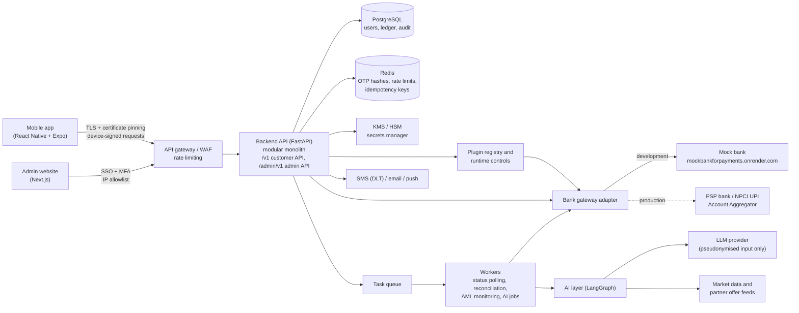

# Payments App: Project Plan

Plan for the `paymentsapp` payments product: a mobile app for customers and an admin website for internal staff. It covers the modules, the project structure, how security is built in, and the regulatory checks. It contains no implementation code.

> The regulatory notes are engineering guidance, not legal advice. A compliance officer or counsel should confirm them before launch. Limits and timelines change, so keep them in config files and never hard-code them.

---

## 1. Product scope

| Capability | What the customer gets |
|---|---|
| Sign-in | Signs in with an email ID or a mobile number using an OTP. The device is bound to the account, and later logins use an app PIN or biometrics. |
| UPI linking | Links their UPI ID (VPA). It is used to add money to the wallet and to withdraw from it. |
| Wallet | Adds money, pays merchants, transfers, and receives refunds and cashback. |
| AI spend insights | Gets insights on spending patterns from wallet transactions and the linked bank account's statement. |
| AI deals and returns | Gets offers and suggestions for getting more value from idle wallet money, based on AI-researched market insights. |

**Applications**

| Application | Used by | Purpose |
|---|---|---|
| Mobile app | Customers | Everything in the table above. During development it runs on an Android emulator (section 7.1). |
| Admin website | Internal staff | Manages partner plugins and runtime controls, including security features (section 3.1). Operations, compliance and support screens are added later (M16). |

**Assumptions**
- Market: India (UPI, INR, RBI/NPCI/SEBI rules).
- Customers must be 18 or older at launch. Minor wallets need guardian flows, which are out of scope.
- Development and demos use the mock bank (https://github.com/arrajase/mockbankforpayments, deployed at `https://mockbankforpayments.onrender.com/`). It is the source of customer bank accounts and the partner bank that holds the wallet's escrow account (section 9). Production needs licensed partners (see section 2).

---

## 2. Read this first: regulations that shape the architecture

These five constraints change the design, so settle them before Phase 1.

1. **A wallet is a Prepaid Payment Instrument (PPI).** Issuing one needs RBI authorisation under the Payment and Settlement Systems Act, 2007. You either get your own PPI licence or issue with a partner bank. Customer money is held in an escrow account at a scheduled commercial bank, and the app keeps the ledger. Design the ledger so that an escrow account can be plugged in.
2. **PPI balances cannot earn interest.** The "maximise returns on wallet money" module therefore cannot pay interest on the wallet. It can offer cashback and rewards, and it can point customers to regulated products (fixed deposits, liquid funds) through licensed partners (see M12).
3. **Personalised investment advice is regulated by SEBI.** Recommending a specific investment product to a specific customer requires one of: a SEBI-registered Investment Adviser, a Research Analyst for published research, or an AMFI-registered distributor for incidental guidance. Until one of these is in place, the deals module ships offers and general education only, behind a feature flag.
4. **UPI is available only through NPCI-certified third-party apps sponsored by a PSP bank (the TPAP model).** UPI requires SIM and device binding to the mobile number registered with the bank. The UPI PIN may only be captured by NPCI's Common Library, so your app never sees it. Email sign-in is fine for the app account, but a verified mobile number is mandatory before UPI linking.
5. **In production, a customer's bank statement must be read through the Account Aggregator (AA) framework,** using a consent artefact. The app then becomes a Financial Information User (FIU), which must be a regulated entity or work through one. In development, the mock bank's statement API stands in for this.

---

## 3. Architecture



**Design principles**
- **Start with a modular monolith.** There is one deployable backend with strict module boundaries. Each module owns its tables, and other modules call its service interface rather than its tables. Payments and the ledger can be split out later if scale requires it.
- **The server is the source of truth for money.** The app never decides that a payment succeeded. It shows what the backend has confirmed with the bank.
- **All money movement takes one path:** payments orchestrator, then compliance and risk checks, then the ledger, then the bank gateway.
- **Bank access sits behind an adapter interface.** The mock bank can be replaced by a PSP bank or an Account Aggregator without changing business logic.
- **AI is advisory and read-only.** No AI component can move money or change account state.
- **Data stays in India.** All infrastructure, backups and logs live in an India cloud region.
- **Partners are plugins.** Each regulated partner (the bank that issues the wallet and holds escrow, the UPI provider, KYC, screening, Account Aggregator) is an adapter that is enabled, disabled or switched from the admin website (section 3.1).
- **The app's own general ledger (GL) is always kept.** Every money movement posts to the app's double-entry ledger, whichever plugin carried it (M4).
- **The admin website changes settings only within limits set in code and config.** Some controls can never be turned off, and production allows less than development (section 3.2).

### 3.1 Plugins (partner providers)

The roadmap's "partner first, licence later" approach, made switchable. Each plugin implements one provider interface:

| Interface | What it does | Development plugin | Production plugin |
|---|---|---|---|
| `IssuerProvider` | Issues the wallet (PPI) and holds customer money in escrow | Mock bank | Partner bank |
| `PaymentProvider` | UPI add money, withdraw, status enquiry, refunds | Mock bank | PSP bank or payment gateway |
| `KYCProvider` | PAN, Aadhaar e-KYC, video KYC, CKYC | Mock | KYC vendor or bank partner |
| `ScreeningProvider` | Sanctions, PEP and negative lists | Static test lists | List provider |
| `AAProvider` | Bank statements with consent | Mock bank statement API | Account Aggregator through a regulated partner |

**Modes.** Each plugin runs in one of three modes:

| Mode | Who holds the money | When it is used |
|---|---|---|
| Mock | Nobody; balances are synthetic | Development and demos |
| Sandbox | The partner's test system | Integration testing |
| Production | The partner bank | Real customers, after the launch gate |

**Rules**
- **No real money without a licensed partner.** Without its own RBI authorisation, the app may hold customer money only through a partner bank. In production, the backend refuses to start if no `IssuerProvider` is enabled in production mode. Turning the issuer plugin off means mock mode, never a self-run wallet.
- **Limits per environment.** `config/providers.yaml` lists which plugins and modes each environment allows. The admin website can switch only within that list, so a development environment can never be set to production mode.
- **Maker-checker.** Enabling, disabling or changing the mode of a plugin is a change request: one admin proposes it, a second approves it, and both actions go to the audit log (M15). Every ledger entry records the plugin and the config version it went through.
- **Secrets are write-only.** An admin can enter a new partner secret (such as the bank API key) on the admin website, but nobody can read one back:
  - The API never returns a secret's value; the website shows only a short preview (for example `mbk_…x9k2`), when it was set and by whom.
  - Secrets are stored encrypted. Development uses field encryption in the database (7.3); production uses the secrets manager behind the same interface.
  - Proposed secrets are held encrypted inside the change request and deleted from it once it is decided. They never appear in the audit log.
  - Only bootstrap secrets stay in the environment: the database URL and the field encryption key, which the backend needs before it can read anything.
  - `seed-plugins` imports the mock bank values from `backend/.env` once; after that the admin website is the source of truth.
- **A plugin with money in it cannot be disabled.** If its escrow or in-transit GL accounts are not zero, it must first go through the switch runbook:
  1. Stop new loads through the plugin.
  2. Settle payments still in transit.
  3. Move the escrow money to the new bank.
  4. Post a transfer journal from the old plugin's escrow GL to the new one.
  5. Reconcile both banks, then switch.
- **Health is visible.** The admin website shows each plugin's latency, error rate, circuit-breaker state and last reconciliation result.

### 3.2 Runtime controls (features and security)

The admin website also manages two kinds of runtime control. Both use the same maker-checker and audit trail as plugins.

**Feature flags** turn product features on and off, and each works as a kill switch: wallet, person-to-person transfers, UPI linking, withdrawals, AI insights, AI deals.

**Security controls** each have three states:
- **Enforce:** the control blocks requests that fail it.
- **Monitor:** failures are logged and sent to the risk engine (M7) as a signal, but nothing is blocked.
- **Off:** the control does not run.

This is also how new security features are developed: a new control ships as Off, runs in Monitor in staging to measure false positives, and then moves to Enforce.

| Control | Development (emulator) | Staging | Production |
|---|---|---|---|
| App attestation (Play Integrity / App Attest) | Off or Monitor | Monitor or Enforce | Enforce |
| Root, emulator and hooking detection | Off or Monitor | Enforce | Enforce |
| Hardware-backed device key | Software key allowed | Enforce | Enforce |
| Certificate pinning | Off or Enforce | Enforce | Enforce |
| Screen-capture protection | Off or Enforce | Enforce | Enforce |
| New-device cooling period | Adjustable | Adjustable | Enforce; length adjustable within bounds |
| OTP and VPA-validation rate limits | Adjustable | Enforce | Enforce; thresholds adjustable within bounds |
| Risk rule thresholds (M7) | Adjustable | Adjustable | Adjustable within bounds |

**Never adjustable from the admin website.** These are fixed in code, because turning them off would break the security model:
- TLS, object-level authorisation, and device-signed requests with nonces.
- Idempotency, ledger database constraints, and hashing of OTPs and PINs.
- The audit log, PII redaction in logs, and the AI guardrails.

**Loosening a control in production** (Enforce to Monitor, or a looser threshold) needs maker-checker approval and alerts the security team. It also expires automatically, for example after 24 hours, unless it is approved again. Production never offers Off.

**The server enforces, the app only follows.** The mobile app fetches a signed snapshot of the current controls at startup and sign-in (`GET /v1/app-config`) to decide its own behaviour, such as whether to pin certificates. The server never relies on the app having obeyed it: if attestation is set to Enforce, a request without a valid attestation token is rejected, whatever the app reports.

---

## 4. Tech stack

| Layer | Choice | Notes |
|---|---|---|
| Mobile | React Native + Expo (TypeScript), expo-router, TanStack Query | Use Expo development builds, not Expo Go, because the security native modules need them. Developed on an Android emulator (Android Studio). Flutter is an equally valid choice; decide before Phase 1. |
| Admin website | Next.js 16 (TypeScript, App Router, server actions), Tailwind CSS | Deployed separately from the customer API, on its own domain, behind SSO and an IP allowlist. Its server calls `/admin/v1`; the browser never talks to the backend and never sees the session token, which sits in an HttpOnly, SameSite=Strict cookie. A per-request CSP nonce is set in `proxy.ts`. Cache Components is off: every page is rendered per request and nothing is cached. |
| Backend API | Python 3.12, FastAPI, Pydantic v2 | Continues the existing Python template. |
| Database | PostgreSQL 16, SQLAlchemy 2 (async), Alembic | The ledger needs ACID transactions and row locking. |
| Cache / short-lived state | Redis | Hashed OTPs, rate limits, idempotency keys, request nonces. |
| Background jobs | Celery + Celery Beat | Payment status polling, reconciliation, AML monitoring, AI batch jobs. |
| AI orchestration | LangGraph + a provider-agnostic LLM client | Keeps the agents/nodes/state/tools layout from the original template. Model names live in `config/params.yaml`. |
| Secrets and keys | Cloud KMS + secrets manager (HSM-backed in production) | `.env` is for local development only. |
| Observability | OpenTelemetry, structured JSON logs with PII redaction | Logs kept for at least 180 days in India. |
| Infrastructure | Docker and docker-compose for development; an India cloud region for production | |
| CI/CD | GitHub Actions | Security scanners are listed in 7.6. |

---

## 5. Project structure

### Scaffolding steps
1. `npx create-expo-app@latest mobile --template blank-typescript` creates the Expo shell, and `npx create-next-app@latest admin-web --typescript --app --src-dir` creates the admin website. Run both first because they expect empty folders.
2. `python template.py` creates the folders and empty files below. It skips `mobile/` or `admin-web/` if step 1 has not been done for it. It is safe to re-run and never overwrites a non-empty file.
3. Install backend dependencies with `uv sync` in `backend/`, then run `uv run alembic init src/paymentsapp/db/migrations`.
4. Fill in `.gitignore` **before** creating any `.env` file. At minimum, ignore `.env`, `*.env`, `__pycache__/`, `node_modules/`, and everything under `data/` except `.gitkeep`.

### Layout

```
paymentsapp/
├── template.py                         # scaffolding script
├── PROJECT_PLAN.md                     # this document
├── README.md
├── docker-compose.yml                  # local postgres, redis, api, worker
├── .github/workflows/                  # CI: lint, tests, SAST/SCA/secret scans, mobile build
├── config/                             # non-secret, versioned, reviewed configuration
│   ├── params.yaml                     # timeouts, LLM model names, feature-flag defaults
│   ├── schema.yaml                     # canonical transaction schema (statements + AI)
│   ├── compliance_limits.yaml          # wallet/UPI limits per KYC tier
│   ├── risk_rules.yaml                 # fraud rules and thresholds
│   ├── aml_scenarios.yaml              # transaction-monitoring scenarios
│   ├── providers.yaml                  # plugins and modes each environment allows (3.1)
│   └── security_controls.yaml          # states and bounds each environment allows (3.2)
├── docs/
│   ├── architecture.md
│   ├── security/                       # threat model, mobile checklist, incident response
│   ├── compliance/                     # regulatory matrix, retention policy, AI governance
│   └── integrations/mockbank-api.md    # mock bank contract and escrow setup (section 9)
├── backend/
│   ├── Dockerfile
│   ├── pyproject.toml, uv.lock         # dependencies, pinned with hashes by uv
│   ├── .env.example                    # names of required variables, no values
│   ├── src/paymentsapp/
│   │   ├── main.py                     # app factory, router registration
│   │   ├── api/                        # dependencies (auth, current user), middleware, v1 router, admin router, webhooks
│   │   ├── core/                       # config, security (tokens), crypto (field encryption),
│   │   │                               # logging (PII redaction), errors, idempotency, rate limits
│   │   ├── db/                         # engine/session, base model; migrations/ created by alembic
│   │   ├── constants/                  # enums, error codes
│   │   ├── modules/                    # one package per business module (section 6)
│   │   │   └── <module>/               # router, schemas, service, models, repository, plus module extras
│   │   ├── integrations/
│   │   │   ├── bank_gateway.py         # IssuerProvider and PaymentProvider interfaces
│   │   │   ├── registry.py             # loads the enabled plugin for each interface (3.1)
│   │   │   ├── mockbank/               # adapter: client, schemas, signing, webhooks, errors
│   │   │   ├── messaging/              # sms, email, push
│   │   │   ├── screening_lists/        # sanctions / PEP list provider
│   │   │   └── market_data/            # rates, offers and market feeds
│   │   ├── ai/
│   │   │   ├── llm/                    # provider-agnostic client
│   │   │   ├── agents/                 # spend_insights, deals_research, deals_recommender
│   │   │   ├── nodes/, state/, tools/  # LangGraph building blocks (tools are read-only)
│   │   │   ├── prompts/                # versioned prompts
│   │   │   ├── guardrails/             # PII redaction, output validation, financial-claims filter
│   │   │   └── evals/                  # evaluation datasets and runners
│   │   └── workers/                    # celery app plus tasks: payment status, reconciliation,
│   │                                   # statement sync, insights, AML monitoring, retention, screening refresh
│   └── tests/                          # unit, integration, contract, security, ai_evals
├── mobile/                             # Expo app (created by create-expo-app)
│   └── src/
│       ├── app/                        # expo-router screens: (auth), (onboarding), (tabs)
│       ├── features/<feature>/         # api.ts, hooks.ts, components/ for each feature
│       ├── core/                       # API client (pinning, signing, idempotency), security, config
│       └── ui/                         # shared components, theme
├── admin-web/                          # Next.js admin website (created by create-next-app)
│   └── src/
│       ├── proxy.ts                    # CSP nonce, security headers, redirect to sign-in without a session
│       ├── app/
│       │   ├── sign-in/                # sign-in page and form
│       │   ├── (console)/              # signed-in pages: plugins, plugins/[key], approvals, audit;
│       │   │                           # later controls, operations, compliance, support
│       │   └── actions.ts              # server actions: sign in/out, propose, approve, reject, withdraw
│       ├── lib/                        # server-only backend client, API types, formatting
│       └── components/                 # shared UI
├── research/                           # prototyping notebooks (synthetic data only)
└── data/                               # local synthetic datasets; never real customer data
```

Backend modules created by `template.py`: `identity, kyc, upi, wallet, payments, risk, compliance, consent, statements, insights, deals, notifications, grievance, audit, admin, plugins, controls`.

---

## 6. Modules

| # | Module | Backend package | Mobile feature | Phase |
|---|---|---|---|---|
| M1 | Identity and access | `modules/identity` | `features/auth` | 1 |
| M2 | Onboarding and KYC | `modules/kyc` | `features/onboarding` | 1 |
| M3 | UPI linking | `modules/upi` | `features/upi` | 2 |
| M4 | Wallet and ledger | `modules/wallet` | `features/wallet` | 3 |
| M5 | Payments orchestration | `modules/payments` | `features/payments` | 3 |
| M6 | Bank gateway (mock bank adapter) | `integrations/` | none | 2 |
| M7 | Risk and fraud engine | `modules/risk` | none | 3–4 |
| M8 | Compliance engine | `modules/compliance` | none | 3–4 |
| M9 | Consent and privacy | `modules/consent` | `features/profile` | 1, 5 |
| M10 | Statements and aggregation | `modules/statements` | none | 5 |
| M11 | AI spend insights | `modules/insights` + `ai/` | `features/insights` | 5 |
| M12 | AI deals and returns | `modules/deals` + `ai/` | `features/deals` | 6 |
| M13 | Notifications | `modules/notifications` | none | 1 |
| M14 | Grievance and disputes | `modules/grievance` | `features/support` | 4 |
| M15 | Audit and observability | `modules/audit`, `core/logging` | none | 0 onward |
| M16 | Admin website | `modules/admin` | `admin-web/` | 0–1 (sign-in, roles), 4 (operations) |
| M17 | Plugins and runtime controls | `modules/plugins`, `modules/controls` | `admin-web/` | 0 onward |

### M1: Identity and access
**Purpose:** account creation, sign-in by email or mobile number, device binding, and sessions.

**Flows**
- **First sign-in:** the customer enters an email or mobile number and receives an OTP (by SMS or email) to verify. The app then registers the device: it creates a hardware-backed key pair (Android Keystore or iOS Secure Enclave) and sends the public key to the server. The customer sets a 4–6 digit app PIN and can enable biometrics, and the server issues tokens.
- **Returning user:** a biometric or PIN unlocks the device's private key, which signs a challenge from the server. No OTP is needed unless the risk is high.
- **Second identifier:** customers who signed up with email must verify a mobile number before linking UPI (M3).
- **Step-up authentication:** before a sensitive action, the customer re-authenticates with PIN or biometric plus the device signature, and an OTP when the risk is high. Sensitive actions are: linking or unlinking UPI, changing mobile or email, payments above a threshold, withdrawals, and adding a new device.
- **New device or reinstall:** requires OTP and PIN. Old sessions are revoked, an alert goes to the existing email and mobile, and limits are reduced for a cooling period (for example 24 hours).

**API:** `POST /v1/auth/otp/request`, `POST /v1/auth/otp/verify`, `POST /v1/auth/devices`, `POST /v1/auth/challenge`, `POST /v1/auth/token/refresh`, `POST /v1/auth/step-up`, `POST /v1/auth/logout`

**Data owned:** users, identifiers (stored with a blind index), devices (public key, attestation result, status), sessions, refresh-token families.

**Controls**
- **OTPs:** 6 digits with a 3–5 minute expiry, stored only as a hash and usable once. After about 5 wrong attempts the identifier is locked. Resends have a cooldown, and OTP requests are rate-limited per identifier, per device and per IP address.
- **No user enumeration:** the response is the same whether or not an account exists.
- **Tokens:** access tokens live 5–15 minutes. Refresh tokens are rotated on every use and bound to the device. If an old refresh token is reused, the whole token family is revoked.
- **App PIN:** never stored in plain text. It is either hashed with Argon2id on the server with an attempt counter, or used only to unlock the device key.
- **Payment authentication:** follows RBI's additional factor of authentication (AFA) rules. Device binding is one factor and PIN or biometric is the other.

### M2: Onboarding and KYC
**Purpose:** verify identity. The customer's KYC tier decides what the wallet can do.

| Tier | How it is reached | Wallet capability |
|---|---|---|
| T0 Registered | Verified mobile or email | App access and insights on the linked bank account (if consented); no wallet |
| T1 Minimum KYC | Verified mobile, self-declared name, and the number of an officially valid document (OVD) | Small PPI: low balance and loading caps, merchant payments only, no bank transfers or person-to-person transfers |
| T2 Full KYC | PAN verification, plus Aadhaar e-KYC, Aadhaar offline XML, DigiLocker, or video KYC (V-CIP); search and upload to the CKYC registry | Full PPI: higher caps, person-to-person transfers, withdrawal to bank |

**Flow:** collect details, verify with a vendor (mocked in development), run sanctions and PEP screening (M8), assign a customer risk category (low, medium or high), assign the tier, and schedule periodic re-KYC according to the risk category.

**Controls**
- Never store a full Aadhaar number. Keep only the masked number or a reference token; if storing it is unavoidable, use a UIDAI Aadhaar Data Vault.
- Encrypt KYC documents and log every access to them.
- Detect duplicates (the same PAN or document used across accounts).
- Enforce the 18+ age check.
- The KYC name is matched against the bank account name in M3.

**API:** `GET /v1/kyc/status`, `POST /v1/kyc/min`, `POST /v1/kyc/full/start`, `POST /v1/kyc/full/complete`

### M3: UPI linking
**Purpose:** link the customer's UPI ID (VPA) to their account as the funding source and withdrawal destination.

**Prerequisites:** a verified mobile number, KYC tier T1 or higher, and a bound, trusted device.

**Development flow (mock bank, section 9)**
1. The customer enters a UPI ID. The backend calls the mock bank's `verify` endpoint for the account holder's name and the currency.
2. Only INR accounts can be linked. The name is matched against the KYC name after normalisation, using a fuzzy-match threshold, and a low score is rejected.
3. The backend requests a `LINK` consent, plus `STATEMENT` if the customer opted in to insights. The customer approves it with their UPI PIN on the mock bank website. The approved consent is the proof of ownership.
4. The link is stored (UPI ID encrypted, with a blind index for lookup, and the consent ID) and set as the default funding source, and the customer is notified.

**Production flow (TPAP through a PSP bank):** SIM binding through an SMS sent from the device, bank account discovery by mobile number, and UPI PIN set and entered only in the NPCI Common Library. For adding money, prefer UPI Intent or QR over Collect requests.

**API:** `POST /v1/upi/validate`, `POST /v1/upi/links`, `GET /v1/upi/links`, `PATCH /v1/upi/links/{id}` (set default), `DELETE /v1/upi/links/{id}`

**Controls**
- Rate-limit VPA validation so it cannot be used to harvest other people's names.
- Show the customer only a masked account-holder name.
- Apply a cooling period and send an alert when a new VPA is linked.
- Cap the number of linked VPAs per customer.
- Require step-up authentication to link or unlink.

### M4: Wallet and ledger
**Purpose:** hold customer balances correctly and auditably.

**Ledger design**
- **Double-entry:** every movement writes balanced entries, so total debits equal total credits.
- **Chart of accounts (GLs):**
  - Customer wallet: a liability, one account per customer.
  - Escrow: an asset, one account per issuer plugin (3.1).
  - In-transit or settlement: one account per payment plugin.
  - Cashback expense, fee income, and suspense.
- **The app's GL is kept in every plugin mode.** In production the partner bank's books are the legal record of the escrow money, and the app's GL is the customer-level subledger that must reconcile to them. Each entry records the plugin and config version it went through.
- **Amounts in integer paise:** never floats. Keep a currency field even though only INR is supported.
- **Append-only:** entries are never updated or deleted, and corrections are made with reversal entries. The application's database role has no UPDATE or DELETE permission on ledger entries.
- **Balances:** a stored balance is updated in the same database transaction as its entries, under a row lock (`SELECT … FOR UPDATE`) or a version check. This prevents double spending from concurrent requests. Database check constraints enforce that the balance is at least 0 and at most the tier cap.

**Operations**
- Add money from a linked UPI ID. Card and net banking come later through an RBI-authorised Payment Aggregator, and the app never touches card data.
- Pay a merchant.
- Wallet-to-wallet person-to-person transfer (T2 only).
- Withdraw to a bank account (T2 only).
- Refunds and cashback credits.
- Wallet closure, which returns the balance to the source or bank account.

**Reconciliation (daily and intraday):** for each enabled plugin, the internal ledger is compared with that bank's escrow statement and transaction report, matching lines by `client_reference`. Bank events for the escrow account that have no matching ledger entry open a case straight away (9.4). Mismatches go to a suspense account and open an operations case. Unresolved mismatches block the end-of-day sign-off.

**API:** `GET /v1/wallet`, `GET /v1/wallet/transactions`, `POST /v1/wallet/add-money`, `POST /v1/wallet/withdraw`, `POST /v1/wallet/close`

### M5: Payments orchestration
**Purpose:** the only component that moves money. It runs every payment through checks, the ledger and the bank as a persisted state machine.

**States**
- `CREATED → CHECKED → AWAITING_AUTH → SUBMITTED → SUCCESS | FAILED | UNKNOWN`
- For add money, `AWAITING_AUTH` covers both the in-app step-up and the customer's approval of the collect request at the bank. If the collect request is declined or expires, the payment becomes `FAILED`.
- `UNKNOWN →` status enquiry `→ SUCCESS | FAILED`
- `SUCCESS → REFUNDED | REVERSED`

Every transition is stored as an event row recording who, when and why.

**Rules**
- **Idempotency:** the client sends an `Idempotency-Key` (a UUID) with every request that moves money. The server stores the key, a hash of the request, and the response. A retry gets back the original result, and a different request body with the same key is rejected.
- **Holds:** funds are held in the ledger before the payment goes to the bank, then either captured or released once the final status is known.
- **Timeouts:** a timeout means `UNKNOWN`, never `FAILED`. A worker retries with the same idempotency key, then queries the bank by `client_reference` (9.4). Failed payments are reversed automatically within RBI's turnaround time.
- **Bank callbacks:** webhooks are verified (signature, timestamp, replay cache). For high-value payments, a status enquiry must agree with the webhook before the final state is set.
- **Side effects:** notifications, monitoring and insights go through a transactional outbox, so none are lost and none are sent for a payment that was rolled back.

**API:** `POST /v1/payments`, `GET /v1/payments/{id}`, `POST /v1/webhooks/mockbank`

### M6: Bank gateway (mock bank adapter)
The mock bank is the first plugin for `IssuerProvider` and `PaymentProvider`. Plugins are described in section 3.1, and the mock bank in section 9.

### M7: Risk and fraud engine
**Purpose:** make a real-time decision on each sensitive action: `ALLOW`, `STEP_UP`, `HOLD` (manual review) or `BLOCK`, always with reason codes.

**Signals**
- Device: integrity and attestation result; root, emulator or hooking flags; a new device or a recent SIM or device change.
- Behaviour: velocity (count and amount per minute, hour and day); amount compared with the customer's usual range; failed PIN or OTP attempts; account age.
- Counterparty: a new beneficiary, or a risky one (previously reported, or receiving from many senders, which is a mule-account pattern).
- Network: IP address or location anomalies.

**Implementation**
- Rules live in `config/risk_rules.yaml`, are versioned, and changes are approved by a second person (maker-checker).
- Rules are evaluated in-process within a budget of about 50 ms.
- Every decision is stored with the rule version and its inputs so it can be replayed in an audit.
- An ML score can be added later as one more signal, never as the only decider.
- When a customer uses "report fraud", outgoing payments from the wallet are frozen immediately.

### M8: Compliance engine
**Purpose:** enforce regulatory rules in code and keep evidence that they were enforced.

| File | Responsibility |
|---|---|
| `limits.py` | Limits per KYC tier (balance cap, monthly and yearly loading, per transaction, per day), read from `compliance_limits.yaml` |
| `screening.py` | Sanctions, PEP and negative-list screening at onboarding and when a beneficiary is added; re-screening whenever the lists update |
| `monitoring.py` | Post-transaction AML scenarios from `aml_scenarios.yaml` |
| `cases.py` | Alert to case to investigation to decision, with maker-checker |
| `reporting.py` | Suspicious Transaction Report (STR) exports for FIU-IND and regulatory reports |
| `retention.py` | Retention schedule and purge jobs |

Details are in section 8.

### M9: Consent and privacy
**Purpose:** consent and data-principal rights under the Digital Personal Data Protection (DPDP) Act.

**Consent purposes**, each recorded separately:
- Payments and KYC: needed to provide the service and to meet legal obligations.
- AI spend insights on linked bank data: a separate opt-in.
- Personalised deals and marketing: a separate opt-in.

**Each consent record holds:** the purpose, data categories, notice version, timestamp, expiry, and withdrawal.

**Rules**
- Withdrawing consent is as easy as giving it (one toggle in Profile). Withdrawal triggers a purge of data that was held only for that purpose.
- Rights requests (access, correction, erasure, grievance, nominee) are tracked against an SLA.
- Erasure is limited where PMLA or RBI rules require retention. The response tells the customer what is kept and why.

**API:** `GET /v1/consents`, `POST /v1/consents`, `DELETE /v1/consents/{id}`, `POST /v1/privacy/requests`

### M10: Statements and aggregation
**Purpose:** fetch, normalise and categorise transactions from the linked bank account and the wallet.

- **Source:** the mock bank's statement API in development, under a `STATEMENT` consent the customer approved at the bank (9.1), and an Account Aggregator in production. Data is fetched only with active consent (M9), and only for the consented date range and frequency.
- **Normalisation:** to the canonical schema in `config/schema.yaml`, with these fields: date, amount in paise, direction, tokenised counterparty, channel, raw narration, category, and confidence.
- **Deduplication:** a transaction that appears in both the wallet and the bank statement is counted once.
- **Categorisation:** a merchant dictionary and rules come first. An LLM handles unknown merchants, with the narration redacted.
- **Storage:** encrypted, and purged when consent is withdrawn or expires.

### M11: AI spend insights
**Purpose:** help customers understand their spending from wallet and linked-account data.

**Principle: code computes the numbers and the LLM only explains them.**

**Pipeline** (LangGraph graph `spend_insights_agent`)
1. **`load_transactions`** loads the customer's normalised transactions. Access is scoped to the customer's ID on the server.
2. **`compute_metrics`** calculates deterministic metrics: spend by category and merchant, month-on-month change, recurring payments and subscriptions, unusual transactions, a cash-flow and month-end balance forecast, and the savings rate.
3. **`detect_patterns`** applies rules and simple statistics to find spend spikes, duplicate subscriptions, and fees and charges.
4. **`generate_narrative`** sends the LLM only pseudonymised aggregates (no names, VPAs or account numbers) and gets back short insight cards.
5. **`validate_output`** checks that every number in the text matches a computed metric, validates against a JSON schema, and checks for banned claims. If any check fails, template text is used instead.
6. **`persist`** stores each insight with the model version, prompt version and the metric snapshot it was based on, which powers the "How was this calculated?" view.

**Outputs:** insight cards (for example "Food delivery up 32% vs last month"), a monthly summary, a list of subscriptions, and budget suggestions. The pipeline runs as a nightly batch, plus an on-demand refresh that is rate-limited.

**API:** `GET /v1/insights`, `POST /v1/insights/refresh`, `POST /v1/insights/{id}/feedback`

### M12: AI deals and returns
**Purpose:** help customers get more value from wallet money within the regulations.

What "returns" can legally mean here:

| Type | Example | Regulatory gate |
|---|---|---|
| Cashback and merchant offers | 5% cashback at partner merchants that match the customer's top spending categories | PPI rules on cashback; offer terms and conditions |
| Savings nudges | "₹4,000 has been idle for 30 days", shown as educational content | General education only; no product is named |
| Regulated products through partners | A fixed deposit with a partner bank, or a liquid mutual fund | SEBI IA or RA registration, or an AMFI distributor arrangement, with risk profiling and suitability checks. Feature-flagged off until in place. |

**Design:** there are two separate stages, so the AI never invents financial claims at runtime.
1. **Research stage (offline batch, `deals_research_agent`):** gathers data from licensed market data feeds, partner offer feeds and public sources. It produces insight cards with source citations, an as-of date and an expiry date. **A compliance reviewer approves each card** in the back-office (maker-checker) before it is published to the catalogue.
2. **Recommendation stage (online, `deals_recommender`):** ranks only approved catalogue items for each customer, using their spend categories, idle balance, risk profile (if collected) and consents. The LLM may rephrase approved text but cannot add rates, returns or products.

**Guardrails**
- No wording such as "guaranteed" or "risk-free".
- Mandatory disclaimers, and disclosure of commissions and partner relationships.
- Expired offers are hidden automatically.
- Every recommendation shown is logged (what was shown, why, and which version) so regulator queries can be answered.
- A "Why am I seeing this?" explanation, and an opt-out.

**API:** `GET /v1/deals`, `GET /v1/deals/{id}`, `POST /v1/deals/{id}/feedback`. Back-office: `POST /admin/deals/cards/{id}/approve`

### M13: Notifications
- **Transaction alerts:** sent for every debit and credit by SMS and push or email. Each alert includes the amount, the balance, a reference, and how to report fraud.
- **Channels:** SMS goes through a provider with a TRAI DLT-registered sender ID and templates. Email uses SPF, DKIM and DMARC.
- **Content:** push notifications never contain OTPs or full account details, and everything sensitive is masked.
- **Security alerts:** sent for a new device, UPI link or unlink, PIN change, and profile changes.

### M14: Grievance and disputes
- **Disputes:** a customer can raise a complaint or dispute from any transaction, with the reference prefilled, and track it in the app.
- **Turnaround times:** tracked according to RBI's rules for failed transactions. Auto-reversal and compensation are calculated in M5 and M14.
- **Escalation:** the app shows the Grievance Redressal Officer and Nodal Officer contacts. If a complaint is not resolved within 30 days, or is rejected, the customer is told about the RBI Integrated Ombudsman Scheme.
- **Unauthorised transactions:** a 24x7 "report unauthorised transaction" option freezes outgoing payments immediately and opens a case. Fast reporting limits the customer's liability.

### M15: Audit and observability
- **Audit log:** records who did what, when, and from which device or IP for every action involving security or money, with before and after values. It also records back-office views of PII. The table is append-only and hash-chained (each row includes the hash of the previous row), and it is exported periodically to write-once storage.
- **Logs:** structured JSON with request and trace IDs. The PII redaction filter in `core/logging.py` masks phone numbers, emails, VPAs, account numbers and tokens. Logs are kept in India for at least 180 days, with clocks synced over NTP.
- **Metrics and alerts:** payment success rate, bank latency and errors, spikes in OTP failures, reconciliation mismatches, the risk engine's block rate, and LLM errors and cost.

### M16: Admin website
The internal website for staff. It is built in Phase 0–1 because plugins and security controls are managed from it. Operations, compliance and support screens are added in Phase 4.

**Access**
- Sign-in with SSO and MFA, restricted to allowlisted IP addresses. In development, local admin users sign in with a password and a TOTP code.
- For local demos, `ADMIN_TOTP_REQUIRED=false` skips the TOTP code. The backend ignores it outside development, and each sign-in without a code is recorded in the audit log.
- A separate origin from the customer API, with short sessions, CSRF protection and a strict Content Security Policy.
- The backend's `/admin/v1` router accepts only admin tokens, and customer tokens are rejected there.

**Roles**

| Role | Can do |
|---|---|
| Viewer | Read plugin status, controls and audit log |
| Platform admin | Propose plugin and control changes (maker) |
| Security approver | Approve or reject plugin and control changes (checker) |
| Operations, compliance, support | Phase 4 screens |

Nobody can approve their own change.

**Phase 4 additions**
- Maker-checker approval for manual ledger adjustments, limit changes, rule changes and deal approvals.
- PII is masked by default, and every "reveal" is logged.

### M17: Plugins and runtime controls
**Purpose:** own the plugin registry (3.1) and the runtime controls (3.2).

- `modules/plugins` stores each plugin's interface, version, mode, status and secret reference. It runs the change-request workflow and health checks, and `integrations/registry.py` reads it to choose the active adapter.
- `modules/controls` stores feature flags and security-control states. It validates every change against `config/security_controls.yaml`, expires production loosening automatically, and serves the signed snapshot to the mobile app.
- Reads are cached in Redis and refreshed when a change is approved, so checks stay fast on the payment path.

**API:** `GET /admin/v1/plugins`, `POST /admin/v1/plugins/{id}/change-requests`, `GET /admin/v1/controls`, `POST /admin/v1/controls/{key}/change-requests`, `POST /admin/v1/change-requests/{id}/approve`, `POST /admin/v1/change-requests/{id}/reject`, `GET /v1/app-config`

---

## 7. Security implementation

### 7.1 Mobile app (OWASP MASVS v2 / MASTG)
| Area | Control |
|---|---|
| Storage | Tokens and keys are stored only in Keychain or Keystore (expo-secure-store). Nothing sensitive goes in AsyncStorage, logs or crash reports, and cached data is cleared on logout. |
| Device binding | A hardware-backed, non-exportable key (StrongBox or Secure Enclave), unlocked by biometric, signs login challenges and payment requests. |
| App integrity | A Google Play Integrity API or Apple App Attest token is sent at login and before payments, and the server verifies it. |
| Runtime protection | Detects root or jailbreak, emulators, debuggers, hooking tools (such as Frida) and repackaging. Results go to the risk engine, and payments are blocked on compromised devices. |
| Network | TLS 1.2 or higher only. Public-key pinning with backup pins and a rotation plan. Cleartext traffic is disabled (Android network security config, iOS App Transport Security). |
| Sensitive screens | On PIN, OTP, balance and KYC screens: Android uses `FLAG_SECURE`; iOS detects screen capture and hides sensitive views. Content is blurred in the app switcher, and the app auto-locks after inactivity. |
| Input | OTP autofill uses the SMS Retriever API, so there is no READ_SMS permission. Tapjacking protection is on, and sensitive fields cannot be copied. |
| Build | No secrets in the app bundle, because anything shipped is public. Release builds strip logs and developer menus and are obfuscated (R8, Hermes bytecode). |
| Deep links | Only verified App Links and Universal Links are accepted, and all parameters are validated. UPI intent results are confirmed on the server. |
| Updates | The app checks a minimum supported version and forces an update for versions with known vulnerabilities. |

**Developing on an emulator.** An Android emulator has no StrongBox, fails Play Integrity and is detected as an emulator, so several controls above cannot pass on it. The development environment's control settings (3.2) allow for this: attestation and emulator detection are Off or Monitor, and a software device key is accepted. Two safeguards stop these settings from reaching real customers:
- Release builds ignore Off for emulator, root and hooking detection.
- The production backend never offers those states.

From the emulator, the backend on the host machine is reached at `10.0.2.2`. Test the hardware-backed paths on a real device before Phase 7.

### 7.2 API and backend (OWASP API Security Top 10, OWASP ASVS)
- **Gateway:** a WAF, TLS termination, request size limits, and HSTS.
- **Object-level authorisation on every endpoint:** the server checks that the requested resource belongs to the caller. Missing checks here (BOLA/IDOR) are the top API risk. Public IDs are random UUIDs, access is denied by default, and automated authorisation tests cover every endpoint.
- **Strict input validation:** Pydantic strict mode, unknown fields rejected, bounds on amounts, and format checks for VPAs and phone numbers.
- **Rate limiting:** per user, device, IP and endpoint, and strictest on OTP, VPA validation and login.
- **Signed payment requests:** the device key signs the method, path, body hash, timestamp and a nonce. The server rejects stale timestamps and reused nonces, which blocks replay attacks.
- **Errors:** the client gets a generic message and an error code. Details go only to logs, and stack traces are never returned.
- **Secrets:** never committed to git. `.env` is for local use only, production reads from a secrets manager, and secrets are rotated on a schedule.
- **Least-privilege database roles:** the application role cannot UPDATE or DELETE ledger entries or audit rows. Migrations run under a separate role.
- **Supply chain:** dependencies are pinned with hashes, and container images are minimal and run as non-root.
- **Admin website:** the admin API is a separate router with its own token audience, and in production it is reachable only from allowlisted IP addresses. Every plugin and control change is a maker-checker change request that is logged in the audit trail (M16, M17).

### 7.3 Data protection
| Class | Examples | Handling |
|---|---|---|
| Never stored | UPI PIN, card CVV, plain-text OTP or app PIN | Never leave the device or the NPCI Common Library. OTPs and app PINs are kept only as salted hashes. |
| Restricted | Aadhaar reference, PAN, account numbers, VPAs, KYC documents | Field-level envelope encryption with KMS, a blind index for lookups, masked in the UI and logs, and every access logged. |
| Confidential | Transactions, balances, statements, insights | Encrypted at rest (database and disk), and accessed only through the module that owns them. |
| Internal | Rule configs, metrics | Standard controls. |

- **In transit:** TLS everywhere, including internal traffic, and mutual TLS with the bank in production.
- **Keys:** managed by KMS and backed by an HSM in production, with separate keys per environment and scheduled rotation.
- **Data localisation:** storage, backups and logs all stay in an India region. Under RBI's data-storage FAQs, payment data processed abroad must be deleted there and brought back to India within one business day or 24 hours. The simplest way to stay compliant is to send the LLM only pseudonymised aggregates (see 7.5).
- **Non-production environments:** use synthetic data only, never copies of production data.
- **Retention:** defined per data type in `docs/compliance/data-retention-policy.md` and enforced by `workers/tasks/retention.py`.

### 7.4 Payment integrity
- Idempotency keys run end to end, from the client through the API to the bank reference.
- Ledger rules are enforced by database constraints and checked by property-based tests.
- Concurrency is handled with row locks or version checks. There is no read-modify-write outside a database transaction.
- The final status comes from bank confirmation, never from the client.
- Webhooks are verified by signature, timestamp window, replay cache and IP allowlist.
- Manual adjustments are made only in the back-office, with maker-checker approval.
- Reconciliation runs daily, and mismatches are handled as cases (M4).

### 7.5 AI-specific security
- **Data minimisation:** the LLM receives pseudonymised aggregates only. Before any prompt, `ai/guardrails/pii_redaction.py` removes names, VPAs, phone numbers, emails and account numbers. Outputs are scanned for leaked identifiers.
- **Prompt injection:** merchant names, transaction narrations and web pages are untrusted text, and a narration could contain "ignore previous instructions". Such text is passed to the model as clearly delimited data, never as instructions.
  - Agent tools are read-only.
  - The customer ID for a tool call is set on the server, never taken from model output.
  - No tool can move money, change settings or read another customer's data.
- **Output validation:** schema checks, a check that every number matches the computed figures, a banned-financial-claims filter, and fallback text if any check fails.
- **Vendor terms:** a data processing agreement, no training on customer data, minimal retention, and a known processing region.
- **Versioning and audit:** the prompt version and model version are stored with every output, and prompts and responses are logged in redacted form.
- **Cost and abuse:** per-customer rate limits, budget alarms, and a kill-switch feature flag for each AI feature.

### 7.6 Secure development lifecycle
- **Repository rules:** branch protection, mandatory review, and CODEOWNERS for `modules/wallet`, `modules/payments`, `modules/compliance` and `core/`.
- **CI pipeline:**
  - Lint and type checks: ruff, mypy.
  - Static analysis (SAST): bandit, semgrep.
  - Dependency vulnerabilities: pip-audit, npm audit.
  - Leaked secrets: gitleaks.
  - Containers and infrastructure: trivy.
  - Software bill of materials (SBOM) generation.
  - Dynamic testing (DAST): an OWASP ZAP baseline scan against staging.
  - Mobile binaries: a MobSF scan of the APK and IPA.
- **Threat model:** a STRIDE threat model for each module, in `docs/security/threat-model.md`, updated whenever the module changes.
- **Penetration testing:** before launch and every year, a vulnerability assessment and penetration test (VAPT) by a CERT-In-empanelled auditor, plus a mobile app penetration test. All critical and high findings are fixed before go-live.
- **Incident response:** a runbook that includes regulator notifications (8.9).

### 7.7 Top threats and mitigations
| Threat | Mitigation |
|---|---|
| SIM swap or account takeover | Device binding with a hardware key; a cooling period with reduced limits on new devices; alerts to the existing email and mobile; SIM-change risk signals |
| OTP brute force or SMS pumping | Attempt caps; rate limits per identifier, IP and device; attestation before sending an OTP; cost alarms |
| Accessing another customer's data by changing an ID in a request (IDOR) | Object-level authorisation checks and automated tests |
| Replaying a payment request | Device signature with timestamp and nonce; idempotency keys |
| Double spending through concurrent requests | Row locks, database constraints, ledger holds |
| A tampered app reporting fake payment success | Payment status comes only from the server; app attestation |
| A repackaged or cloned malicious app | Play Integrity or App Attest, pinning, obfuscation, takedown monitoring |
| Harvesting names through VPA validation | Rate limits, masked names, step-up authentication |
| Mule accounts | AML many-to-one scenarios and beneficiary risk scores |
| Insider misuse of PII | Role-based access, maker-checker, masked PII, logged reveals, access reviews |
| Prompt injection through transaction narrations | Untrusted-data handling and read-only tools (7.5) |
| PII leaking to the LLM vendor | Redaction, aggregates only, and a vendor data processing agreement |
| A compromised admin account turns off security controls or switches a plugin | Maker-checker; per-environment limits on what can change; core controls that can never be changed from the admin website; production loosening that expires and alerts the security team; SSO, MFA and an IP allowlist |

---

## 8. Regulatory and compliance checks

### 8.1 Licensing path for each capability
| Capability | What is required | Development approach | Production path |
|---|---|---|---|
| Wallet | PPI authorisation from RBI, or issuing through or with a partner bank | Internal ledger, with escrow in a mock bank account (9.2) | Partner bank or your own Certificate of Authorisation |
| UPI | NPCI third-party app provider (TPAP) model with a sponsor PSP bank | Mock bank VPA APIs | PSP bank sponsorship and NPCI certification |
| Bank statements | Account Aggregator framework; the FIU must be a regulated entity | Mock bank statement API | AA integration through a regulated partner |
| Add money by card or net banking | An RBI-authorised Payment Aggregator | Not in the MVP | Payment Aggregator integration with hosted checkout (keeps the app out of PCI DSS scope) |
| Investment suggestions | SEBI IA or RA registration, or an AMFI distributor arrangement | Education only, behind a feature flag | Licensed partner or own registration |
| KYC | RBI KYC rules, the CKYC registry, an authorised UIDAI agency for Aadhaar | Mocked vendors | A KYC vendor or bank partner |

### 8.2 Regulatory matrix
| Regulation or guideline | What it requires, in short | Where in the app |
|---|---|---|
| Payment and Settlement Systems Act 2007 + RBI Master Directions on PPIs (2021, as amended) | Authorisation; KYC tiers and limits; escrow; no interest on balances; AFA for debits; closure and refund; customer protection | M2, M4, M5, M8 |
| RBI Master Direction on KYC (2016, as amended) | Customer due diligence, officially valid documents, video KYC (V-CIP), CKYC registry, risk categories, periodic KYC updates | M2 |
| PMLA 2002 and PML Rules 2005 | An AML programme, screening, STRs to FIU-IND, record keeping, a Principal Officer | M8 |
| NPCI UPI procedural guidelines and circulars | TPAP model, device and SIM binding, Common Library for the PIN, transaction limits, dispute handling (UDIR) | M3, M5, M14 |
| RBI Master Directions on Cyber Resilience and Digital Payment Security Controls for non-bank payment system operators (2024) | Information security governance, app security, MFA, logging, VAPT, incident response, vendor risk | Section 7 |
| RBI directions on authentication mechanisms for digital payment transactions (2025) | Two-factor authentication (AFA), with risk-based options beyond SMS OTP | M1, M5 |
| RBI Storage of Payment System Data (2018) and FAQs | Payment data stored only in India | Infrastructure, 7.3, 7.5 |
| RBI turnaround times and compensation for failed transactions (2019) | Auto-reversal timelines and compensation | M5, M14 |
| Reserve Bank Integrated Ombudsman Scheme 2021 | Grievance redressal and escalation | M14 |
| RBI Account Aggregator Directions (2016) | Consent-based financial data sharing and FIU obligations | M9, M10 |
| DPDP Act 2023 and DPDP Rules 2025 (phased commencement; confirm the dates that apply) | Notice, consent, purpose limitation, data-principal rights, breach notification, retention | M9, 7.3 |
| CERT-In Directions (28 April 2022) | Report incidents within 6 hours, keep logs for 180 days in India, sync clocks via NTP | M15, 8.9 |
| SEBI Investment Adviser Regulations 2013, Research Analyst Regulations 2014, AMFI distributor code | A licence for personalised advice or research; suitability; disclosures | M12 |
| RBI FREE-AI framework (2025) | Responsible AI governance, explainability, human oversight | M11, M12, 8.7 |
| TRAI TCCCPR 2018 (DLT) | Registered SMS sender IDs and templates | M13 |
| Aadhaar Act and UIDAI regulations | Aadhaar e-KYC only through authorised agencies; masking; Aadhaar Data Vault | M2 |

### 8.3 Where the checks run in a transaction's life
**Before a transaction** (synchronous and in this order). The checks fail closed: if a check cannot run (for example, the screening service is down), the payment does not go ahead.

| Step | Check | Module | If it fails |
|---|---|---|---|
| 1 | Valid session, bound and trusted device, recent app attestation | M1 | Reject, or ask the customer to sign in again |
| 2 | Account status: not frozen, not closed, no legal hold | M8 | Reject |
| 3 | KYC tier allows this operation (for example, withdrawals and person-to-person transfers need full KYC) | M2, M8 | Prompt the customer to upgrade KYC |
| 4 | Limits: per transaction, daily, monthly loading, yearly loading, balance cap, cooling-period limits | M8 | Reject with a message naming the limit |
| 5 | Beneficiary checks: sanctions and negative lists, new-beneficiary cooling period | M8 | Hold or reject |
| 6 | Risk score | M7 | Step-up, hold or block |
| 7 | Additional factor of authentication (PIN or biometric plus device signature) | M1 | Reject |
| 8 | Place a ledger hold, then submit to the bank | M4, M5 | None |

Every step writes a decision record containing the payment ID, the check, the result, a reason code, the rule or config version, and a timestamp. An auditor can replay any decision from these records.

**After a transaction** (asynchronous): customer alerts (M13), AML monitoring (M8), ledger posting and reconciliation (M4), and an insights refresh (M11).

**Periodic checks**
- Re-screening customers when sanctions lists update.
- Re-KYC according to each customer's risk category.
- Handling dormant wallets.
- Retention purges.
- Reconciliation sign-off.
- Reviews of limits and rules.
- Access reviews for back-office users.
- Key rotation.

**How compliance rules are implemented**
- Limits, risk rules and AML scenarios are versioned YAML in `config/`.
- Changes are reviewed by pull request and approved in the back-office by a second person (maker-checker).
- The rules are loaded by `modules/compliance` and `modules/risk`.
- Each rule version is recorded in every decision record.

### 8.4 Limits configuration (`config/compliance_limits.yaml`)
These are indicative values as understood when this plan was written. **Compliance must confirm them against the current RBI PPI Master Direction and NPCI circulars before they are used.**

| Limit | T1 Small PPI (minimum KYC) | T2 Full-KYC PPI |
|---|---|---|
| Maximum balance at any time | ₹10,000 | ₹2,00,000 |
| Loading per month | ₹10,000 | Within the balance cap |
| Loading per financial year | ₹1,20,000 | Within the balance cap |
| Transfers to a bank or another wallet | Not allowed | Allowed, within the limits in the PPI Master Direction |
| Cash withdrawal | Not allowed | As per the PPI Master Direction |
| UPI transaction (from the linked bank) | Bank and NPCI limits (typically ₹1,00,000 per transaction for person-to-person) | Same |

Add the app's own limits on top of these: a lower cap during the new-device cooling period, a lower cap for a beneficiary's first payment, and caps per risk category.

### 8.5 AML/CFT programme
- **Screening:** the UN Security Council consolidated list, the MHA lists of individuals and organisations designated under UAPA, and internal negative lists. Customers are screened at onboarding, when a beneficiary is added, and again whenever a list updates.
- **Monitoring scenarios** (`config/aml_scenarios.yaml`, to be tuned with compliance):

| Scenario | Example rule |
|---|---|
| Pass-through (load and withdraw quickly) | At least 80% of loaded money moves out within 24 hours, repeatedly |
| Structuring | Many loads just below a limit within a short period |
| Many-to-one (mule account) | One wallet receives money from many unrelated senders |
| One-to-many | One wallet pays many new beneficiaries in quick succession |
| Dormant spike | High-value activity after 6 months of inactivity |
| Profile mismatch | Volume far above the customer's declared income or occupation band |

- **Case workflow:** an alert becomes a case, an analyst investigates, and a second person (maker-checker) approves the decision.
- **STR filing:** a Suspicious Transaction Report is filed with FIU-IND within 7 working days of concluding that a transaction is suspicious.
- **No tipping off:** the customer is never told about an STR, so the app shows only neutral holds.
- **Roles:** a Principal Officer and a Designated Director.
- **Record keeping:** transaction and KYC records are kept for the period PMLA requires (5 years, counted from the transaction or from the end of the relationship, depending on the record). The retention job must not purge them early, even after an erasure request.

### 8.6 Data protection (DPDP)
- **Privacy notice:** clear, versioned, and available in the languages you support, shown before any data is collected.
- **Consent:** collected per purpose and kept separate from the terms and conditions (M9). Withdrawal is simple, and stopping processing on withdrawal is enforced in code.
- **Purpose limitation:** AI insights read linked-bank data only while that consent is active.
- **Data-principal rights:** access, correction, erasure, grievance and nomination, each with an SLA and audit trail.
- **Breach notification:** the Data Protection Board and affected customers are notified as the Rules require. The playbook is in `docs/security/incident-response.md`.
- **Significant Data Fiduciary:** if the app is designated as one, it must also carry out data protection impact assessments, independent audits, and appoint a Data Protection Officer.

### 8.7 AI governance (RBI FREE-AI; SEBI if advising)
- **Model inventory:** purpose, owner, data used and risk level for each AI component, kept in `docs/compliance/ai-governance.md`.
- **Explainability:** every insight and recommendation shows "why" and what data it used.
- **Human oversight:** compliance approves market insight cards before they are published, and samples generated insights periodically.
- **Quality and fairness:** the evaluation suite runs on every prompt or model change, and complaints about AI outputs are monitored.
- **Disclosure:** customers are told that AI is used. If the app registers as an IA or RA, recent SEBI amendments make the registered entity responsible for its AI tools' outputs and require disclosing AI use to clients. Confirm the current text.
- **Controls:** a kill switch for each AI feature, and an opt-out that does not affect core payments.

### 8.8 Customer protection
- An alert for every debit and credit.
- 24x7 fraud reporting with an instant freeze on outgoing payments, which limits the customer's liability.
- Failed transactions reversed automatically within RBI's turnaround time (for example, T+1 day for many UPI and PPI failure cases), with compensation of ₹100 per day after that. Confirm each scenario against the RBI circular.
- Clear fees, and terms and conditions whose acceptance is recorded by version.
- Wallet closure with a refund of the balance.
- A visible grievance officer and information about the ombudsman (M14).

### 8.9 Incident and regulatory reporting
| To | What | When |
|---|---|---|
| CERT-In | Reportable cyber incidents | Within 6 hours of noticing |
| RBI | Cyber incidents and unusual events | As set out in the PSO directions and any partner bank agreement |
| Data Protection Board and affected customers | Personal data breaches | As the DPDP Rules require |
| FIU-IND | STRs and other reports required under PMLA | As in 8.5 |

Supporting controls: logs kept for 180 days in India, clocks synced over NTP, and a tested incident runbook.

---

## 9. Mock bank integration (development and demo)

The mock bank is the partner bank for development and demos. Source code: https://github.com/arrajase/mockbankforpayments; deployed at https://mockbankforpayments.onrender.com. It is a FastAPI service with its own customers, accounts, general ledger and UPI IDs, and holds no real money.

It plays two roles:
- **Source:** customers' bank accounts, their UPI IDs and their statements.
- **Partner bank for the wallet:** the app's escrow account, which holds all wallet money, is an account in the mock bank (the mock `IssuerProvider` plugin, section 3.1).

**Status.** The mock bank implements the whole contract below as of commit `9c71655` (3 October 2026). The app's adapter targets this contract only. The mock bank's README is the reference for request and response fields; `docs/integrations/mockbank-api.md` records how the app uses them.

### 9.1 API used by the app

**Authentication.** Each API client has its own key, sent as `x-api-key`. The bank stores only a hash of each key. Every API client is tied to an owner customer in the mock bank, and the keys can do only these things:
- Pay directly from UPI IDs that the owner customer holds, which are the escrow and operating accounts.
- Take money from a customer only through a collect request that the customer approves.
- Read a customer's balance or statement only under an active consent.

**Common rules**
- Amounts are integer paise, and every request and response carries `currency`, which must be `INR`.
- The bank sets the dates: `created_at` is UTC, and `tran_date` is the date in IST.
- Every call that moves money needs an `Idempotency-Key` (a UUID) and a `client_reference`. The `client_reference` is unique per client and is shown in statements.
- Errors use one format: `{"error": {"code", "message", "retryable"}}`. The adapter retries only when `retryable` is true.
- A replayed request (same `Idempotency-Key`, same body) returns the stored response with the header `Idempotent-Replayed: true`, and no money moves.
- Insufficient funds is a recorded outcome, not just an error: `422 INSUFFICIENT_FUNDS` carries a `transaction` with `status: FAILED`, which can later be looked up by its `client_reference`.

| Endpoint | Purpose | Used for (app module) |
|---|---|---|
| `GET /upi/{upi_id}/verify` | Account holder name, currency, status; no balance. Rate-limited | UPI ID validation (M3) |
| `POST /consents`, `GET /consents/{id}`, `GET /consents?upi_id=&status=` | Customer-approved permission to link (`LINK`), read statements (`STATEMENT`) or read balance (`BALANCE`), with a date range and expiry | Proof of ownership (M3), statements (M10), consent records (M9) |
| `POST /collect-requests`, `GET /collect-requests/{id}` | Request money from a customer's UPI ID. The customer approves with their UPI PIN on the mock bank website. States: `PENDING`, `SUCCESS`, `FAILED`, `DECLINED`, `EXPIRED` | Add money (M4, M5) |
| `POST /upi/{upi_id}/pay` | Transfer from a client-owned UPI ID to any UPI ID. The bank locks the accounts and checks currency | Merchant payments, withdrawals, cashback funding (M4, M5) |
| `GET /transactions/{id}`, `GET /transactions?client_reference=` | Status and details of one of the client's own transactions | Resolving `UNKNOWN` payments (M5) |
| `GET /upi/{upi_id}/statement?from=&to=&limit=&cursor=` | Paged statement with counterparty, narration, client reference and balance after each line | Reconciliation (M4), insights (M10) |
| `GET /upi/{upi_id}/balance` | Balance of a client-owned UPI ID, or a customer's with a `BALANCE` consent | Reconciliation (M4) |
| Webhooks to the client's URL, and `GET /events?after=` | `transaction.posted`, `collect_request.updated`, `consent.updated`. Signed with `X-MockBank-Signature: t=<unix>,v1=<HMAC-SHA256 of "t.body">`; delivered at least once, with `X-MockBank-Event-Id` | Payment status (M5), tamper detection on escrow (M4) |
| `GET /health` | Warm-up ping | Adapter (9.5) |

The UPI PIN is set and entered only on the mock bank website, never in the app. This mirrors the production rule that only NPCI's Common Library captures the UPI PIN (section 2).

**Consents the app did not request.** A customer can also switch access on or off for the app from the **App Access** section of their mock bank profile, without the app asking. The app receives these as `consent.updated` events and handles them like this:
- An `ACTIVE` `LINK` consent counts as proof of ownership only for a link the customer started in the app (M3). It never creates a link by itself.
- A revoked or expired consent stops the matching reads straight away, and triggers the M9 purge of data held only for that purpose.

### 9.2 Setup (once per environment)

1. On the mock bank website, sign up one business customer for the company, for example "PaymentsApp".
2. Give it two INR accounts, Escrow and Operating, each with its own UPI ID, for example `paymentsappescrow@okmockbank` and `paymentsappops@okmockbank`.
3. Issue an API client for the app, owned by that customer, with the mock bank's CLI (`create-client --owner <customer_id>`). Set its webhook URL to the app's `POST /v1/webhooks/mockbank`. Put the key and the webhook secret in the secrets manager (`.env` locally). The key is shown only once.
4. Register the escrow and operating UPI IDs as the mock issuer plugin on the admin website (3.1).
5. Check that the escrow balance is zero. From then on it must always equal the sum of all customer wallet GL balances.

Use separate escrow accounts and API clients for each environment (development, staging, demo), so one environment's GLs never reconcile against another environment's money.

**Running locally.** The mock bank's own docker-compose serves it on `http://localhost:8000` (with its Postgres on port 5433), so the app's backend uses port 8001. The hosted mock bank cannot reach a backend on a laptop, so for local work either run the mock bank locally with the webhook URL set to `http://host.docker.internal:8001/v1/webhooks/mockbank`, or rely on the `GET /events` poller (9.5).

Merchants and test customers are created as ordinary customers on the mock bank website. Each has an INR account, a UPI ID and a UPI PIN.

### 9.3 How the app's flows map to the mock bank

| Flow | Mock bank calls | App ledger entry (M4) |
|---|---|---|
| Link a UPI ID (M3) | `GET /upi/{id}/verify`; then `POST /consents` with `LINK` (and `STATEMENT` if the customer opted in to insights). The customer approves on the mock bank website | None |
| Add money | `POST /collect-requests` from the customer's UPI ID to escrow. The customer approves with their UPI PIN; the result comes by webhook or `GET /collect-requests/{id}` | On `SUCCESS`: debit escrow (asset), credit customer wallet (liability) |
| Pay a merchant | `POST /upi/{escrow_upi}/pay` to the merchant's UPI ID | Hold on the wallet, then on success: debit customer wallet, credit escrow |
| Withdraw to the customer's bank | `POST /upi/{escrow_upi}/pay` to the customer's linked UPI ID | Same as paying a merchant |
| Wallet-to-wallet transfer | None; the money stays in escrow | Debit sender's wallet, credit receiver's wallet |
| Cashback | `POST /upi/{operating_upi}/pay` to escrow | Debit escrow, credit customer wallet; debit cashback expense, credit operating cash |
| Spend insights (M10) | `GET /upi/{customer_upi}/statement` with the `STATEMENT` consent; stands in for the Account Aggregator | None |
| Reconciliation (M4) | `GET /upi/{escrow_upi}/statement` and `/balance`, plus `transaction.posted` webhooks | Escrow balance equals the escrow GL; every statement line matches a ledger entry by `client_reference` |

**Add money in the app.** After the backend creates the collect request, the app shows "Approve ₹X on MockBank" with a button that opens the mock bank website's pending-requests page. The app then waits for the final state and shows it only after the backend has confirmed it. The request expires after 15 minutes at most.

### 9.4 Payment status and retries

- Each payment's `client_reference` is the app's payment ID, and its `Idempotency-Key` is stored with the payment. Retrying with the same key never moves money twice.
- **On a timeout or a 5xx response:**
  1. The payment becomes `UNKNOWN`.
  2. The worker retries the same request with the same idempotency key, with backoff.
  3. If retries are exhausted, the worker calls `GET /transactions?client_reference=` to settle the status.
- **Webhooks:** signatures and timestamps (within 5 minutes) are checked, and `event_id` is deduplicated. A webhook moves a payment to a final state only if `GET /transactions` agrees, for every payment while on the mock bank and for high-value payments in production.
- **Unexpected escrow movements:** a `transaction.posted` event on the escrow account with no matching `client_reference` immediately opens a reconciliation case (M4) and alerts operations.

### 9.5 Adapter and resilience

**Adapter design:** `integrations/bank_gateway.py` defines the `IssuerProvider` and `PaymentProvider` methods the rest of the app depends on:
- `verify_vpa`
- `request_consent`, `get_consent`
- `create_collect`, `get_collect`
- `pay`
- `get_transaction`
- `fetch_statement`, `get_balance`
- `verify_webhook`, `poll_events`

`integrations/mockbank/` implements it. Production adapters for a PSP bank and an Account Aggregator implement the same interface and are selected by config.

**Resilience**
- Explicit timeouts on every call.
- Retries only when the bank marks the error `retryable`, and for calls that move money only with the original idempotency key.
- Exponential backoff with jitter that respects `Retry-After`.
- A circuit breaker.
- Cold-start handling: a warm-up ping to `/health` in development, with 503 treated as retryable.
- An event poller (`GET /events?after=`) that catches up on any webhook the app missed, for example while the hosted mock bank was asleep.
- A local stub built from recorded responses for unit tests and offline development.
- Nightly contract tests against the live mock bank to catch API changes.
- Mock bank test triggers (`SANDBOX_TRIGGERS=true`) for failure cases, chosen by the last two digits of the amount in paise:
  - `13`: the money moves, then the bank waits 30 seconds before answering, so the app times out.
  - `14`: the money moves but the bank returns 500.
  - `15`: 503 with no money moved.
  - `16`: the collect request expires immediately.

**Security in development too:** credentials only in a local `.env` that is never committed, TLS verification always on, and redacted request and response logs.

### 9.6 Mock bank changes

All 15 changes listed for the mock bank have shipped, in commits `60f6a29`, `4bfa7f5` and `9c71655` (3 October 2026): idempotency keys, client references and status lookup, locked balance updates, INR and currency checks, bank-set dates, website sessions, per-client API keys, collect requests, consents, `verify`, signed webhooks and `/events`, statement paging, the common error format, sandbox triggers, and Alembic with docker-compose. The workarounds the app needed for the original API are no longer needed, and the adapter has no compatibility mode for it.

When the mock bank's contract changes again, update 9.1 and `docs/integrations/mockbank-api.md`, and let the nightly contract tests (section 11) confirm the adapter still matches.

---

## 10. Delivery roadmap

| Phase | Scope | Done when |
|---|---|---|
| 0. Foundations | Scaffold, CI with security scanners, docker-compose, config loading, logging with redaction, audit log, first version of the threat model, mock bank contract documented. Admin website skeleton with sign-in and roles (M16); plugin registry with mock plugins and the controls page (M17); mobile development build running on the Android emulator | CI passes, the threat model is reviewed, there are no secrets in the repo, and a control change made on the admin website is approved by a second admin and changes the app's behaviour on the emulator |
| 1. Identity and onboarding | M1, M2 (minimum KYC, mocked full KYC), basic consents from M9, OTP and alerts from M13, mobile auth and onboarding screens | Sign-in by email and by mobile works on the emulator, OTP abuse tests pass, and authorisation (IDOR) tests pass, including admin and customer tokens used on the wrong API |
| 2. Bank and UPI | M6 adapter with retries, circuit breaker, webhooks and event poller; M3 linking with bank-approved consent; plugin enable and disable from the admin website, plugin health view | A UPI ID can be linked and unlinked against the mock bank, contract tests against the mock bank run in CI, and disabling a plugin that has a GL balance is refused |
| 3. Wallet and payments | M4 ledger, M5 orchestration, first version of M7 rules, M8 limits | Ledger rules hold under concurrency tests, retries are idempotent, and the reconciliation report is clean |
| 4. Compliance hardening | M8 screening, monitoring and cases; M14; basic M16 back-office | AML scenarios raise alerts on test data, and the dispute flow meets turnaround times |
| 5. Statements and AI insights | M10 and M11, gated by consent | The evaluation suite passes: every number matches, no PII in prompts, and injection tests pass |
| 6. Deals | M12 offers and education, with investment features behind a flag | Compliance signs off the content approval workflow |
| 7. Launch readiness | VAPT by a CERT-In-empanelled auditor covering the mobile app and the admin website, testing on real devices, production plugin switched on for the partner bank, disaster recovery drill, policy documents, partner certification | No open critical or high findings, and every security control in production is set to Enforce |

---

## 11. Testing strategy
- **Unit tests** for every module's services.
- **Integration tests** with PostgreSQL and Redis in testcontainers, plus API tests for each endpoint.
- **Authorisation tests:** every endpoint is called as the owner, as another customer, unauthenticated, and from the wrong device. This catches IDOR bugs.
- **Ledger property tests (Hypothesis):** entries always balance, balances never go negative, replaying a request with the same idempotency key changes nothing, and concurrent debits never overdraw.
- **Contract tests:** against a stub on every pull request, and against the live mock bank nightly.
- **Failure-path tests:** use the mock bank's test triggers (9.5) to cover timeouts, a lost response after money moved, 503s and expired collect requests. They check that no payment is ever recorded twice or left `UNKNOWN` without being resolved.
- **Compliance tests:** limit boundaries (exactly at the limit, and one paisa over), screening hits, and AML scenarios triggered on synthetic data.
- **Security tests:** SAST, DAST and dependency scanning in CI, plus abuse tests for the OTP and VPA-validation rate limits.
- **AI evaluations:**
  - golden datasets for insights, where every number must match
  - PII-leak tests
  - a set of prompt-injection attempts hidden in narrations
  - banned-claims tests for deals
- **Mobile tests:** Jest unit tests, and end-to-end tests with Maestro or Detox on the emulator. Run the end-to-end suite with security controls in each state (Off, Monitor, Enforce) to cover both the root and emulator detection paths.
- **Admin website tests:**
  - Role checks: each role is allowed or refused each action, and nobody can approve their own change.
  - Changes outside the environment's limits are refused.
  - Production loosening expires on time.
  - End-to-end tests with Playwright.
- **Performance tests:** k6 or Locust on the payment and OTP paths.

---

## 12. Decisions needed from you
1. **Mobile framework:** this plan assumes React Native with Expo on an Android emulator. If you prefer Flutter, switch now; it only affects `mobile/`. Testing on an iOS simulator needs a Mac.
2. **Admin website framework:** this plan assumes Next.js. Any React web framework works, and the choice only affects `admin-web/`.
3. **Partner bank:** which bank issues the wallet and holds escrow, as the first production `IssuerProvider` plugin (3.1). Your own PPI authorisation can come later as another plugin.
4. **Deals scope:** offers and education only, or regulated investment products too. The latter needs a SEBI or AMFI arrangement.
5. **LLM provider and processing region.**
6. **Cloud provider** (in an India region).
